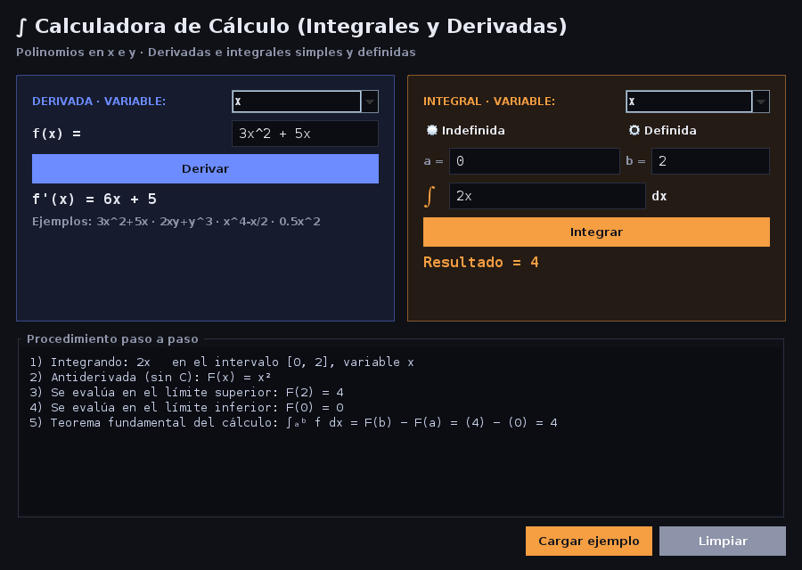

# Manual de usuario — CalculadoraCalculo

Calculadora de **derivadas e integrales** (simples y definidas) de polinomios en las variables **x** e **y**.

## 1. Requisitos
- Java 17 o superior (JRE) instalado.

## 2. Cómo ejecutarla
- Doble clic en `dist/CalculadoraCalculo.jar`, o desde una terminal:
  ```
  java -jar dist/CalculadoraCalculo.jar
  ```

## 3. La ventana


| Zona | Función |
|---|---|
| **Derivada** (izquierda, azul) | Lista *variable* (x / y), campo `f(x) =`, botón **Derivar** y resultado. |
| **Integral** (derecha, naranja) | Lista *variable*, opción **Indefinida / Definida**, límites **a** y **b** (solo en definida), campo del integrando, botón **Integrar**. |
| **Procedimiento paso a paso** | Muestra cómo se obtuvo el último resultado. |
| **Cargar ejemplo** | Carga f(x)=3x²+5x y ∫₀² 2x dx (resultados: 6x+5 y 4). |
| **Limpiar** | Borra campos, resultados y procedimiento. |

## 4. Cómo escribir las funciones
| Escriba | Significa |
|---|---|
| `3x^2 + 5x` | 3x² + 5x |
| `x^3 - 4x + 7` | x³ − 4x + 7 |
| `2xy + y^3` | 2xy + y³ (dos variables) |
| `0.5x^2` o `x^2/2` o `1/2x^2` | medio de x² (decimales y fracciones) |
| `3x²` | también se aceptan superíndices copiados |

Reglas: exponentes enteros ≥ 0 (con `^`), signo `*` opcional, sin paréntesis (expanda antes), solo variables `x` e `y`. Se aceptan mayúsculas, espacios y coma decimal.

## 5. Procedimientos
**Derivar:** 1) elija la variable; 2) escriba la función; 3) pulse **Derivar** (o Enter en el campo). Si hay otra variable (p. ej. derivar `2xy + y³` respecto de x) esta se trata como constante y el resultado se muestra como ∂f/∂x.

**Integral indefinida:** 1) elija variable; 2) deje marcada *Indefinida*; 3) escriba el integrando; 4) **Integrar**. El resultado incluye `+ C`.

**Integral definida:** 1) elija variable; 2) marque *Definida*; 3) escriba los límites `a` y `b` (enteros, decimales o fracciones, ej. `-1`, `0.5`, `1/3`); 4) escriba el integrando y pulse **Integrar**. Se calcula F(b) − F(a). Si el resultado es fraccionario, se muestra también su valor decimal aproximado.

## 6. Mensajes de error
| Mensaje | Causa y solución |
|---|---|
| La expresión está vacía. | Escriba una función. |
| Carácter no válido: 'z' … | Solo se permiten números y las variables x, y. |
| No se admiten paréntesis… | Expanda la expresión, ej. `(x+1)^2` → `x^2 + 2x + 1`. |
| Exponente inválido… | Use exponentes enteros no negativos de hasta 2 cifras. |
| Falta un término después de un signo… | Elimine el `+` o `-` sobrante. |
| Escriba el límite inferior/superior. / …no es un número válido. | Complete o corrija a y b. |

## 7. Ejemplos resueltos
| Operación | Entrada | Resultado |
|---|---|---|
| Derivada en x | `3x^2 + 5x` | f'(x) = 6x + 5 |
| Derivada parcial en y | `2xy + y^3` | ∂f/∂y = 3y² + 2x |
| Integral indefinida en x | `3x^2 + 5x` | x³ + 5x²/2 + C |
| Integral definida en [0,2] | `2x` | 4 |
| Integral definida en [1,3] | `x^2` | 26/3 ≈ 8.666667 |
